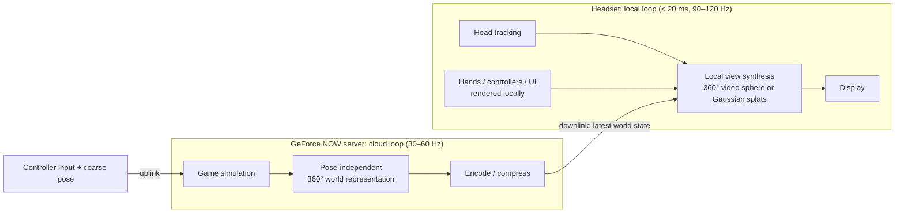

# Pose-Independent Cloud VR

### Streaming a complete 360° world representation per frame so the headset, not the network, owns motion-to-photon latency

**Author:** Pol Barreiro Font
**Date:** 22 September 2026
**Addressed to:** NVIDIA GeForce NOW and NVIDIA CloudXR teams
**License:** [CC BY-NC-ND 4.0](https://creativecommons.org/licenses/by-nc-nd/4.0/) (see [LICENSE](../LICENSE))

---

## 0. Summary

GeForce NOW supports VR headsets (Apple Vision Pro, Meta Quest, Pico) only as a **big virtual screen for flat games**. Since 19 March 2026 that screen streams at 90 fps. Native VR titles are not offered. The reason is physiological: in VR, any delay between a head movement and the matching image causes simulator sickness. Comfort needs a motion-to-photon latency of about **20 ms**, and a round trip to a datacenter, plus rendering, encoding and decoding, cannot reliably fit inside that.

The root cause is architectural. **In today's cloud VR, the streamed image depends on the head pose.** Every head movement has to go to the server and back before the correct pixels exist. Prediction and late reprojection hide part of that delay, but they break down as the round-trip time grows.

**The proposal removes the head pose from the network loop.** For every game frame, the server produces a lightweight representation of the *whole* 360° surroundings of the player. The headset renders the final eye views locally, at native refresh rate, from the most recent representation and the freshest local head pose. This is what headsets already do when they play a 360° video or show a Gaussian-splat scene, and neither causes latency sickness.

With this split:

- **Head motion → image** stays entirely on the device: < 20 ms at 90–120 Hz, whatever the network latency.
- **Network latency affects only interaction latency**: the delay between a button press and the world reacting. Players already accept that in flat cloud gaming.

Two complementary implementations are proposed:

| | **Solution A: Gaussian-splat stream** | **Solution B: 360° video stream** |
|---|---|---|
| Idea | Each frame is sent as 3D Gaussians (in practice, deltas to a persistent Gaussian scene) | Each frame is rendered as a full 360° (stereo) panorama and sent as video, like a YouTube 360° video |
| Freedom of movement | Full 6DoF, rendered locally | 3DoF (3DoF+ with depth) |
| Frame rate felt by the user | Native display rate (90–120 Hz); object motion interpolated | Head rotation at native rate; world content at a stable 30 fps |
| Downlink | Low (≈ 10–200 Mbps, see §4.5) | High (≈ 200 Mbps – 1 Gbps) |
| Server cost | Low to medium | High (full 360° render + encode at 30 fps) |
| Maturity | Research → product | All building blocks exist today |

**Solution A** is the best long-term option: high frame rate, high quality and low bandwidth. **Solution B** can ship much sooner with existing video decoders and 360° players, at the cost of much more server compute and bandwidth.

---

## 1. The problem

### 1.1 Why flat cloud gaming works and cloud VR makes people sick

In flat cloud gaming, latency is *interaction latency*: you press a button and the character reacts 40–80 ms later. That is noticeable but not physically uncomfortable, because the screen stays fixed in the room.

In VR the display is attached to the head. When the head turns, the vestibular system registers the motion at once, and the visual system expects the world to counter-rotate at the same moment. If the image lags behind the head, the world seems to "swim" and the visual–vestibular conflict causes cybersickness. The widely used comfort target for **motion-to-photon (MTP) latency is about 20 ms**.

### 1.2 The cloud latency budget

The table below shows an *illustrative* MTP budget when the eye images are rendered in the cloud for a given head pose:

| Stage | Typical range |
|---|---|
| Pose sampling and packetization | 1–2 ms |
| Uplink (client → datacenter) | 5–30 ms |
| Game simulation and stereo render | 5–11 ms |
| Hardware encode (NVENC) | 2–5 ms |
| Downlink (datacenter → client) | 5–30 ms |
| Jitter buffer | 0–10 ms |
| Hardware decode | 3–8 ms |
| Compositor and display scan-out | 5–11 ms |
| **Total** | **≈ 26–107 ms**, and variable |

Even the best case is above 20 ms, and the jitter (sudden spikes) is especially uncomfortable.

### 1.3 Why prediction and reprojection are not enough over WAN

Viewport-based XR streaming, such as CloudXR, renders the eyes for a *predicted* pose. The client then applies late-stage reprojection (asynchronous timewarp) with the real pose. This works well on a LAN or a very close edge server. It degrades as the round-trip time grows:

- **Prediction error grows with latency.** Head acceleration cannot be predicted far ahead.
- **Rotational reprojection exposes pixels that were never rendered** at the edges of the view. A larger guard band costs more pixels and bandwidth.
- **Translational error** (leaning, crouching, walking) creates parallax and disocclusion artifacts that 2D reprojection cannot fix.
- **Latency spikes** show up as judder and black borders exactly when the user moves fast.

CloudXR 6.0 (GTC 2026) targets mainly local or near-edge RTX servers and asks for ≥ 200 Mbps for local streaming. GeForce NOW, which runs from regional datacenters, keeps VR headsets in "big screen" mode.

**Root cause: the content of each streamed frame is a function of the head pose. Every head movement therefore needs a network round trip.**

---

## 2. The idea: take the head pose out of the network loop

1. **The server never renders "what the user sees".** It renders or produces **what surrounds the user**: the whole sphere of directions and, for 6DoF, a volume around the head.
2. **The headset owns the camera.** Every display refresh, it renders both eyes from the latest world representation it has received, using its freshest local head pose. Head motion never waits for the network.
3. **Hands, controllers and UI are drawn locally** at their local pose. The server still receives the poses for game logic (hits, grabs, collisions). This keeps the player's own body free of lag, which matters as much for comfort and presence as the head does.
4. **Network latency only delays world updates.** An enemy's motion or an explosion arrives 40–100 ms later than on a local PC. That is the same *kind* of latency players already accept on GeForce NOW for flat games.

This is the same reason 360° videos and Gaussian-splat captures are comfortable in VR even though they were produced long before they are viewed. The proposal makes the server produce such content **live, for every game frame**.

---

## 3. Solution B: 360° video stream (implementable now)

This is the simpler, near-term option. It is described first because it reuses existing technology end to end.

### 3.1 Server side

1. **360° camera instead of a stereo camera.** The game renders every frame as a full panorama around the player's head position:
   - **Cube map**: 6 faces of 90° each, with little wasted resolution. Or **equirectangular**, which is compatible with every 360° player.
   - **Stereo** through **omnidirectional stereo (ODS)** rendering, the technique behind stereo 360° video. Unity (360 stereo capture) and Unreal (stereo panoramic capture) already support it. Stereo fades to mono near the poles to avoid ODS distortion when looking straight up or down.
   - **Variant with depth (RGB-D)**: send a mono or stereo panorama plus a depth map. The client can then correct small head translations (3DoF+) and synthesize stereo for nearby objects.
2. **Rendering cost.** A full sphere has roughly 3–6× the pixels of a normal stereo VR view. Several techniques reduce the cost:
   - **Multi-view rendering and simultaneous multi-projection** (NVIDIA VRWorks) to render all cube faces in one pass.
   - **Non-uniform quality.** Within one round trip a head cannot turn more than a few tens of degrees, even at peak speeds of several hundred degrees per second. The hemisphere the user faces, plus a guard band, is rendered at full resolution. The back of the sphere uses variable-rate shading and lower resolution, and is upscaled with **DLSS**. If the user turns around quickly, they see the content immediately, just slightly softer for about one round trip.
   - **30 fps world rate** (the target of this solution): stable, high resolution, and a 3–4× smaller server load than 90–120 fps. A 60 fps tier can be offered where capacity allows.
3. **Encoding.** NVENC AV1 or HEVC in a low-latency configuration (no B-frames, intra refresh), with **tiled encoding**. Tiles near the current view direction get more bitrate, and the rest of the sphere always stays present.

### 3.2 Resolution and bandwidth (back-of-envelope)

- Target about 20 pixels per degree, which is close to current headsets. A cube face of 1920 × 1920 covers 90° ≈ 21 px/deg. Six faces × two eyes ≈ **44 Mpx per frame**, or ≈ 1.3 Gpx/s at 30 fps.
- With lower resolution behind the user, or a mono far field plus depth (stereo parallax is negligible beyond about 10 m), this drops to ≈ 0.6–0.9 Gpx/s. That is within the reach of the ~8K-class hardware video decoders in current standalone headsets.
- At low-latency AV1/HEVC rates of ≈ 0.1–0.7 bits per pixel, this gives **≈ 100 Mbps (good) to ≈ 1 Gbps (near-lossless)**. A **1 Gbps** connection gives comfortable headroom for high quality, and gigabit fibre is common in many markets.

### 3.3 Client side

- Decode the video and map it onto a sphere or cube around the head. **This is what every 360° video player already does.**
- Render both eyes at the display's native refresh rate with the latest head pose. Head rotation is effectively instant.
- **RGB-D variant**: depth-based reprojection for small translations of a few tens of cm, with disocclusions filled from the previous frames or by inpainting.
- **Smoothing 30 fps world content**: stream motion vectors with each frame and extrapolate them on the sphere (similar to asynchronous spacewarp). Moving objects then look smooth at 90 Hz even though the world updates at 30 Hz.
- Hands, controllers and the HUD are composited locally on top.

### 3.4 Strengths and limits

- ✅ Uses existing codecs, decoders and 360° playback. Any game can use it with a camera swap in the engine, without changing gameplay code.
- ✅ Well suited to **seated and cockpit games** (racing, flight, space sims, where the player's head stays in one place). These are the titles already showcased on CloudXR, such as iRacing and X-Plane 12.
- ⚠️ No real 6DoF: standing and room-scale games are limited to small translations with RGB-D.
- ⚠️ High server GPU cost per user and high bandwidth.
- ⚠️ World content at 30 fps. Motion-vector extrapolation is needed for fast-moving objects.

---

## 4. Solution A: Gaussian-splat stream (the target architecture)

### 4.1 Why Gaussians

**3D Gaussian Splatting** (Kerbl et al., SIGGRAPH 2023) represents a scene as millions of small 3D Gaussians. Each one has a position, a shape (scale and rotation), an opacity and a view-dependent colour (spherical harmonics). It rasterizes very fast and gives photoreal results. For cloud VR it has three key properties:

- **It is 3D and independent of the viewpoint.** The headset can render any head pose, including translation, with correct stereo and parallax, at native refresh rate: **full 6DoF with local MTP**.
- **It changes gradually.** Between two game frames, most of the Gaussians do not change. The stream can be **temporal deltas**, not full frames. That is why it can be both **high frame rate and low bandwidth**.
- **NVIDIA is already active in this field** (3DGRT, 3DGUT, neural compression). Tensor Cores make on-the-fly Gaussian generation practical on the server.

"Generating every frame as Gaussians" in practice means that **the server keeps a live Gaussian model of the player's surroundings and streams every change to it, each frame.**

### 4.2 Two server-side paths

#### A-native: engine integration (best quality, lowest bandwidth)

1. **Static world → baked Gaussians.** Each level or area is converted to Gaussians offline. This can be done by optimizing against many engine renders, which is standard 3DGS training, or by converting meshes and materials directly. The baked data is streamed **progressively and cached** on the headset, like texture streaming or level loading, with LOD by distance.
2. **Rigid and skinned objects → transforms only.** Characters, vehicles and props carry their own baked Gaussians bound to bones or object transforms, as in animatable Gaussian avatars. Each frame the server sends **only bone and object transforms**, a few bytes per object, just like networked game-state replication.
3. **Non-rigid content** (fire, smoke, water, destruction, particles) → new or updated Gaussians, compressed. It can also come from simulation data (particle positions and colours), which maps naturally onto Gaussians.
4. **Lighting changes** (time of day, muzzle flashes, destructible lights) → colour or low-order spherical-harmonic deltas for the affected regions. Alternatively, a small relighting term evaluated on the client.

#### A-generic: per-frame reconstruction (works with unmodified games)

For games without engine integration, the server renders **360° RGB-D views around the player's head**: a cube map plus a few slightly offset viewpoints to capture parallax, at 30–60 Hz. A **feed-forward Gaussian network** on the GPU turns them into Gaussians every frame. Models in the style of pixelSplat or MVSplat predict Gaussians from images in one pass, without per-scene training. Only Gaussians that changed compared with the client's copy are sent. This path costs more bandwidth and server compute than A-native, but it needs no work from the game developer.

### 4.3 Transport and compression

- **Quantization**: positions stored relative to spatial cells (16-bit), rotations as compressed quaternions, colours and SH through codebooks or palettes, then entropy coding.
- **Importance and visibility budgeting on the server**: nearby, salient and moving content first. A hard cap on the Gaussian count the client can render.
- **Temporal coding**: a persistent ID per Gaussian or object, sending only *add / update / remove* operations.
- **Loss tolerance**: packets are independent per spatial cell. A lost update leaves the previous state in place, so there are no corrupted frames as with video.

### 4.4 Client side

- **A GPU splat rasterizer** on the headset (Vulkan / compute): stereo, depth-sorted and foveated where eye tracking exists. It renders at 90–120 Hz with the freshest head pose. **No reprojection is needed for head motion.**
- **Entity interpolation and extrapolation**, the standard netcode technique. Object transforms arrive at 30–60 Hz and are interpolated to the display rate, so moving objects stay smooth.
- **A hybrid far field**: beyond a certain distance, the scenery can be shown as a low-rate 360° panorama (Solution B at very low bitrate) instead of Gaussians. This keeps the client's Gaussian budget for the near field, where parallax matters.
- Hands, controllers and UI are rendered locally, as in Solution B.

### 4.5 Bandwidth (back-of-envelope, to be validated)

| Content | Example | Rate |
|---|---|---|
| Baked static world | 10–100 MB per area, streamed during loading and cached | one-time |
| Skinned characters (A-native) | 20 characters × 60 bones × 12 B × 60 Hz | ≈ 7 Mbps |
| Effects and dynamic Gaussians | 10 k Gaussians × 12 B × 30 Hz | ≈ 30 Mbps |
| **Total, A-native** | | **≈ 10–40 Mbps** |
| **Total, A-generic** (5–10 % of ≈ 300 k Gaussians change per frame, 60 Hz) | | **≈ 50–200 Mbps** |

For comparison, today's flat 4K GeForce NOW streams already use tens of Mbps. A-native would deliver **6DoF VR at native refresh rate for similar bandwidth**.

### 4.6 Open challenges (stated honestly)

- **View-dependent effects** (mirror reflections, sharp speculars, refraction) are only approximated by low-order SH. They can use local screen-space tricks, or a video layer for those surfaces.
- **Dynamic lighting and shadows** on baked Gaussians need a relighting scheme.
- **Client GPU budget**: current standalone headsets can render on the order of hundreds of thousands to about a million splats at VR frame rates, depending on resolution and optimization. The budget must be enforced on the server, and the hybrid far field helps.
- **Engine integration** is a real cost for developers. A-generic reduces it, but at higher bandwidth.
- **Asset protection**: part of the game's visual data now sits on the client. Encryption and in-memory-only caching are needed, as with other streamed assets.
- **Interaction-sensitive VR games** (rhythm games, fencing, shooting) still feel the network in *interaction* latency. This can be reduced with server-side lag compensation that uses the client's time-stamped local hand poses, as competitive shooters already do. It is never as good as local play.

---

## 5. Comparison

| | Viewport streaming (today) | **B: 360° video** | **A: Gaussian stream** |
|---|---|---|---|
| Head rotation → photon | Network RTT, partly hidden by reprojection | **Local (< 20 ms)** | **Local (< 20 ms)** |
| Head translation | Reprojection artifacts | None (3DoF); small with depth (3DoF+) | **Full 6DoF, local** |
| World update rate | = stream fps | 30 fps (60 optional), plus extrapolation | 30–60 Hz, interpolated to 90–120 Hz |
| Downlink | ~100–200+ Mbps | ~200 Mbps – 1 Gbps | ~10–200 Mbps |
| Server GPU per user | 1× stereo view | ~3–6× stereo view (less with non-uniform quality) | Low (native) / medium (generic) |
| Client requirements | Video decode + reprojection | Video decode + 360° sphere projection | GPU splat renderer |
| Game compatibility | Native VR games | Any game with an engine camera swap | Engine plug-in (native) or any game (generic) |
| Tolerance to WAN latency and jitter | Low | **High** | **High** |
| Maturity | Shipping | **All components exist** | Research → product |

---

## 6. Proposed roadmap

1. **Phase 1: 360° video mode (B) for seated and cockpit games.** Extend the GeForce NOW / CloudXR client with a "360° world stream" mode. Use ODS or cube-map rendering and NVENC tiled AV1 on the server, with local hands and UI. Start with racing and flight simulators.
2. **Phase 2: RGB-D 3DoF+ and 60 fps tiers.** Add depth-based local reprojection for small translations, and motion-vector extrapolation on the sphere.
3. **Phase 3: Gaussian stream (A).** Ship Unreal and Unity plug-ins for A-native, and a feed-forward A-generic path for unmodified games. Use a hybrid near-field Gaussian / far-field video mode on standalone headsets.
4. **Throughout:** measure MTP on the device, interaction latency and comfort (for example with SSQ questionnaires) on real WAN connections from GeForce NOW regions.

---

## 7. Why NVIDIA is in a unique position

- **GeForce NOW datacenters** with RTX GPUs, NVENC AV1 and tiled encoding at scale.
- **The CloudXR client stack** already on Quest, Pico and Apple Vision Pro, with foveated streaming.
- **Research leadership in Gaussian rendering** (3DGRT, 3DGUT) and in neural compression and reconstruction on Tensor Cores.
- **DLSS and Reflex** to make full-sphere rendering affordable and keep interaction latency low.
- **Developer relationships** (RTX Remix, VRWorks) to bring engine plug-ins to studios.

---

## 8. Related work and building blocks

This proposal combines known building blocks into a product architecture for cloud VR gaming at datacenter distances:

- B. Kerbl, G. Kopanas, T. Leimkühler, G. Drettakis. *3D Gaussian Splatting for Real-Time Radiance Field Rendering.* ACM TOG (SIGGRAPH), 2023.
- G. Wu et al. *4D Gaussian Splatting for Real-Time Dynamic Scene Rendering.* CVPR 2024.
- D. Charatan et al. *pixelSplat.* CVPR 2024. Y. Chen et al. *MVSplat.* ECCV 2024. (Feed-forward Gaussian prediction.)
- N. Moenne-Loccoz et al. *3D Gaussian Ray Tracing.* SIGGRAPH Asia 2024. Q. Wu et al. *3DGUT.* CVPR 2025. (NVIDIA.)
- S. Peleg, M. Ben-Ezra, Y. Pritch. *Omnistereo: Panoramic Stereo Imaging.* IEEE TPAMI, 2001. Google, *Rendering Omni-directional Stereo Content* (ODS).
- Z. Lai et al. *Furion: Engineering High-Quality Immersive Virtual Reality on Today's Mobile Devices.* MobiCom 2017. (Pre-rendered panoramic background combined with local foreground.)
- K. Boos, D. Chu, E. Cuervo. *FlashBack: Immersive Virtual Reality on Mobile Devices via Rendering Memoization.* MobiSys 2016.
- K. Lee et al. *Outatime: Using Speculation to Enable Low-Latency Continuous Interaction for Mobile Cloud Gaming.* MobiSys 2015.
- Asynchronous timewarp / spacewarp (Oculus / Meta). NVIDIA CloudXR 6.0 (GTC 2026). GeForce NOW VR 90 fps update (19 March 2026).

---

## 9. License and contact

© 2026 Pol Barreiro Font. This document is licensed under **Creative Commons Attribution-NonCommercial-NoDerivatives 4.0 International (CC BY-NC-ND 4.0)**. You may share it with attribution, for non-commercial purposes, without modifications. For any other use, including commercial use, please contact the author.

Contact: polbarreirofont@gmail.com
